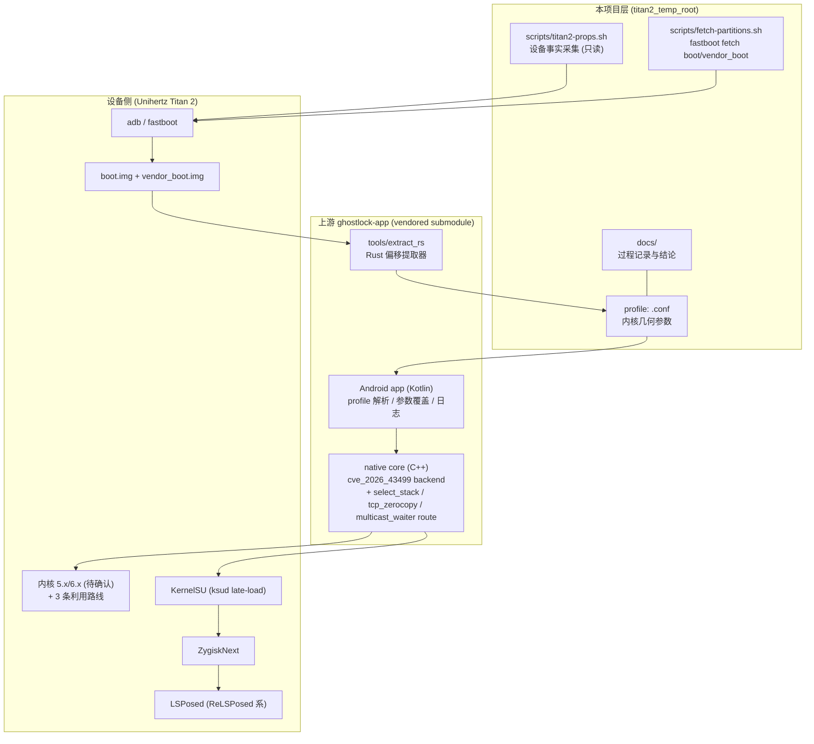

# System architecture

## 分层

## 各层职责

- **本项目层**：把「一台设备的未知参数」变成「一份可审阅、可复现的 profile」。
  只有新增 profile 与登记 `index.conf` 两步会改上游 submodule，其余改动都留在本层。
- **提取器**：从镜像里恢复 kallsyms → 符号偏移；从 BTF（或内核源码）→ 结构体布局；
  从 `vendor_boot.img` 头 → MTK 物理加载地址；内置 arm64 反汇编器 → `pselect_waiter_shift`
  与 `off_slide_loggers_0_1`；内核证据 → 推荐路线。**输出只是候选**，不代表设备受支持。
- **app**：按 `uname -r` 精确匹配内置 profile；解析失败或字段缺失会阻止执行；
  提供「通用参数覆盖」与「高级覆盖」两层现场调参，不必每次重编 APK。
- **native core**：W1（写 `selinux_state.enforcing` 等）/ W2（写凭据）/ W3（seccomp 绕过）
  三阶段，配合选定的 route 完成提权，随后把 root 交给 frontend 并加载 KernelSU。
- **设备侧**：KernelSU 以 late-load 方式进内存 → 装 ZygiskNext → 装 LSPosed 模块。

## 边界

- profile 与设备是**一对一**关系：`release` 字符串必须与 `uname -r` 逐字符一致，否则 app 判定不支持。
- 物理地址（`kernel_phys_load` / `kernel_phys_offset`）不属于「结构体几何」，但同样决定成败；
  取不到时走 app 内高级覆盖页迭代，不改源码。
