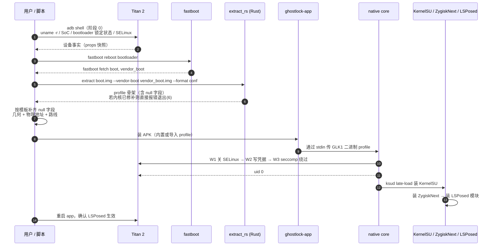

# Key flows

## 失败点与回退

| 失败点 | 现象 | 处理 |
| --- | --- | --- |
| 内核已打补丁 | extractor 退出码 6 / 明确提示 patched `remove_waiter()` | 路线作废 → 换其他临时 root 手段（记录否定结论） |
| `fastboot fetch` 不支持 | bootloader 报未知命令 | 改用官方固件包；或先用其他手段取得 root 再 dump |
| 物理地址错 | W1 反复重试到上限后 `Write 1 failed` | 用 app 高级覆盖页改 `kernel_phys_load` / `kernel_phys_offset` 迭代 |
| 路线不适用 | 利用失败或内核 panic | 换 route（`multicast_waiter` / `tcp_zerocopy` / `select_stack`），改 profile 里的路线分支 |
| 竞态不稳 | 偶发成功偶发失败 | 调 `execution`（尝试次数 / 等待 / CPU 绑定），设备降温后再试 |
