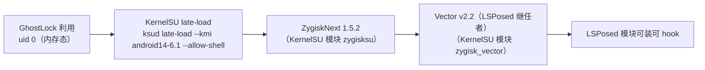

<!-- compiled_truth -->
## 链路（在 Titan 2 上已逐步验证）

## 已在真机跑通的步骤（2026-10-21）

| 环节 | 命令 / 做法 | 结果 |
| --- | --- | --- |
| 利用 | `adb shell /data/local/tmp/ghostlock --load-prebuilt-profile /data/local/tmp/profile.bin` | `[+] child is root!`（uid 0） |
| SELinux 修复 | root 脚本 `load_policy` + fixup | `policy fixup rc=0`，恢复 enforcing |
| KernelSU | 装官方 KernelSU v3.3.1 管理器（`me.weishu.kernelsu`），再跑一次利用 | `ksud late-load --kmi android14-6.1 --allow-shell` → `late-load exit=0`，`/proc/modules` 出现 `kernelsu` |
| shell 即 root | `su -c id` | `uid=0(root) context=u:r:ksu:s0` |
| ZygiskNext | `ksud module install zygisknext.zip` → `ksud post-fs-data` | `zn-daemon` 起来；`znctl status` 显示 `root_status: ✅KernelSU`、`inject_state: 1` |
| Vector/LSPosed | `ksud module install vector.zip` + 装 `manager.apk` → 重启 zygiskd 让它重扫模块 | `znctl status` → `modules64:1,zygisk_vector`；`cli status` → `Framework Version: 2.2 / API Version: 102` |
| 模块管理 | `cli modules ls/enable/disable`、`cli scope add/ls/rm/set` | 可用（`Enabled Modules: 0` = 还没装模块） |

## 关键经验（下次直接照抄）

1. **late-load 的 KMI 要对上**：本机 `uname -r` = `6.1.145-android14-11-…` → KMI = `android14-6.1`；
   KernelSU release 里要有 `lkm-aarch64-android14-6.1_kernelsu.ko`（官方 v3.3.1 有）。
2. **模块是「pending」的**：`ksud module install` 先落到 `/data/adb/modules_update/<id>`，
   要再跑一次 `ksud late-load` 才会搬进 `/data/adb/modules/` 并执行 stage 脚本。
3. **zygiskd 必须在模块装好之后重启**，否则它扫不到新模块（`Modules: 0`）：
   `znctl stop` → 重新跑 `ksud post-fs-data` → `znctl dump-zn` 就能看到 `modules64:1,...`。
4. **zygote 要重起一次**才能吃到注入：`ksud soft-reboot` 或杀 zygote 让 init 重拉。
5. **Vector 的 daemon 必须用绝对路径启动**：daemon 脚本内部用 `dirname` 定位自己，
   相对路径会让 `-Djava.class.path=daemon.apk` 变成相对路径 → `UnsatisfiedLinkError`
   → daemon 静默退出（2026-10-22 真机踩到）。设备上的 toybox `unshare` 不支持
   `--propagation slave`，用 `unshare -m /data/adb/modules/zygisk_vector/daemon`。
6. **宿主（Windows）下载 GitHub release**：`github.com`/`objects.githubusercontent.com` 不通，
   但 `api.github.com` 与 `release-assets.githubusercontent.com` 通 →
   `https://api.github.com/repos/<owner>/<repo>/releases/assets/<id>` + `Accept: application/octet-stream`。
   并发写同一个文件会写坏，下载要串行。
7. **宿主与本机之间传文件**：a2mcp 的 `/xfer/` 路由支持 **PUT 上传**，
   `curl -H 'Authorization: Bearer <token>' -T <file> https://<tunnel>/xfer/<name>`。

## 失效边界

- 临时 root 与 late-load 的 KernelSU 都只在**本次开机**有效；重启后回到原点。
- ZygiskNext / Vector 的模块文件在 `/data/adb/modules/` 里，但 KernelSU 没了就不会被加载。
- 设备当前是**锁屏有密码**状态（`wm dismiss-keyguard` 无效），要动 manager UI 需要用户解锁。
- 手机重启后处于 `RUNNING_LOCKED` 时 CE 存储没建好，侧载 app 起不来
  （报 `Activity class ... does not exist`，看着像 APK 坏了）。**每次重启后先解锁**。

## app 路线（2026-10-22 已落地）

app 自己用 `ProcessBuilder` 拉起 `libghostlock.so` 跑利用，**不再依赖任何外部 helper app**
（Shizuku 依赖已彻底删除：gradle 依赖、UserService + AIDL、执行入口、UI 开关、
profile 里的 `recommend_shizuku` 字段全部移除）。

三个必须记住的点：

1. **组件包放 app 的 external files dir**：ksu 域读不了 app 私有目录（`app_data_file`），
   共享存储任何域可读。每次发布用唯一目录名 `modules-published-<timestamp>`：
   重装 app 会换 uid，旧目录属主还是旧 uid，写不进去。
2. **root script 不继承环境变量**（`execl` 执行），路径只能由 `RuntimeConfig` 读环境变量
   后转义注入脚本正文。
3. **杀 zygote 有硬前置**：`inject_state:1` 且 `modules64` 含 `zygisk_vector` 才允许杀；
   不满足就**不杀**（宁可这一轮不激活 LSPosed，也不把设备带进 recovery）。

2026-10-22 真机证据（app 路线）：`policy fixup rc=0` → `late-load exit=0` →
`[+] KernelSU module loaded` → `[*] modules dir=/storage/emulated/0/Android/data/<pkg>/files/modules-published-<ts>`。
**利用拿 root 成功、组件包发布成功**；LSPosed 框架激活那一步仍卡在设备掉线（见 [[porting-blockers]]）。

## Timeline

- time: 2026-10-21T03:35:20
  kind: decision
  summary: "Created this page: 从临时 root 到 LSPosed 生效的完整链路"
  source: "上游 ghostlock-app 文档 + KernelSU/LSPosed 生态常识"
  affects: [temp-root-to-lsposed]

- time: 2026-10-21T03:35:34
  kind: decision
  summary: "固化临时 root → LSPosed 的链路与失效边界"
  source: "上游 ghostlock-app 文档 + 生态常识"
  affects: [temp-root-to-lsposed]

- time: 2026-10-21T06:28:27
  kind: decision
  summary: "真机验证整条链路：临时 root → KernelSU late-load → ZygiskNext → Vector(LSPosed) 框架"
  source: "宿主机真机（2026-10-21）"
  affects: [temp-root-to-lsposed]

- time: 2026-10-21T06:28:27
  kind: evidence
  summary: "真机跑通 临时root → KernelSU late-load → ZygiskNext → Vector(LSPosed 2.2) 框架，模块管理 CLI 可用"
  source: "宿主机真机操作 + 逐段日志"
  affects: [temp-root-to-lsposed]

- time: 2026-10-21T07:05:10
  kind: note
  summary: "踩坑：杀 zygote / Vector daemon 重启 system_server 会让 Titan 2 framework 起不来 → Android rescue party → 掉进 recovery（recovery 的 adbd 关着，adb/fastboot 都够不着，只能物理重启）"
  source: "真机两轮实验（2026-10-21）"
  affects: [temp-root-to-lsposed]

- time: 2026-10-21T10:29:05
  kind: evidence
  summary: "Vector(LSPosed 2.2/API 102) 在 Titan 2 上激活成功；关键：起 Vector daemon 前必须等 zygote 注入稳定 60 秒，否则 framework 挂掉→recovery"
  source: "真机五步流程（late-load → su 域装模块 → late-load → zygiskd → 等 60s → Vector daemon）"
  affects: [temp-root-to-lsposed]

- time: 2026-10-21T11:01:43
  kind: note
  summary: "未解决：模块 hook 生效、cli status 正常，但 Vector 管理器首页仍显示「异常」(Mismatched)；已排除 daemon 挂/未注入/模块未加载/纯网络/管理器代次不一致（重装后仍异常），判断为管理器状态判定/状态通知通道的 cosmetic 问题"
  source: "真机 18:47 复查"
  affects: [temp-root-to-lsposed]

- time: 2026-10-22T00:38:59
  kind: evidence
  summary: "adb shell 与 Shizuku UserService 执行环境等价（uid 2000 / u:r:shell:s0 / 无 seccomp），native 里有 'no app seccomp filter (adb/shell flow); skipping W3' 的对应分支。因此利用阶段不需要 Shizuku：scripts/run-exploit.sh（adb 跑利用）+ scripts/start-lsposed.sh（root 后用 root 权限跑脚本装模块起 LSPosed）。Shizuku 在本机（MediaTek）反而是坏的（#1198）"
  source: "native 源码 + 真机验证路线"
  affects: [temp-root-to-lsposed]

- time: 2026-10-22T03:31:57
  kind: evidence
  summary: "2026-10-22 真机全链路验证通过：利用一次命中拿 root（tcp route calls=1 success=1）→ KernelSU late-load → 装 ZygiskNext+Vector → 杀 zygote64 让 ZygiskNext injector 接管（inject zygote succeed，新 zygote 带 -Xzygote）→ zygote_states:1 / modules64:1,zygisk_vector → Vector daemon 起来 → cli status 报 Framework 2.2 / API 102 / Enabled Modules 12。adb shell 与 Shizuku UserService 执行环境等价（uid 2000 / shell 域 / 无 seccomp），故 LSPosed 栈改走 adb 路线，手机不必装 Shizuku"
  source: "真机验证（Titan 2 / Android 16 / MediaTek）"
  affects: [temp-root-to-lsposed, porting-blockers]

- time: 2026-10-22T05:25:14
  kind: decision
  summary: "app 路线定为不依赖 Shizuku：adb shell 与 Shizuku UserService 是同一执行环境（uid 2000 / shell 域 / 无 seccomp），而 Shizuku 官方 13.6.0 在 MediaTek 上 UserService 必崩（#1198）。app 侧组件包改发布到 external files dir（ksu 域可读，app 私有目录读不到），native root script 用 su 进 ksu 域装模块（shell 域写不了 modules_update），组件包路径由 RuntimeConfig 注入脚本正文（root script 用 execl 执行、不继承环境变量）。另：kernelsu 已加载但 su 未挂进 namespace 时必须补跑 late-load"
  source: "2026-10-22 真机验证"
  affects: [temp-root-to-lsposed, porting-blockers]

- time: 2026-10-22T08:30:28
  kind: decision
  summary: "app 路线落地：Shizuku 依赖彻底删除、组件包发布、杀 zygote 硬前置"
  source: "docs/titan2-shizuku-removal-2026-10-22.md + 真机 ksu 日志"
  affects: [temp-root-to-lsposed]

- time: 2026-10-22T17:48:31
  kind: evidence
  summary: "app 路线执行顺序的硬约束（2026-10-22 真机）：root child = u:r:kernel:s0，只能在 SELinux permissive 窗口内做事；策略重载（load_policy）和 ksud late-load 都会把它推回 enforcing。因此 app 路线要么把「装模块 / post-fs-data / 起 Vector daemon / 重启 zygote」全部放在 late-load 之前（路线 P1），要么在 late-load 之后再补一次 selinux_state 写（路线 P2，属攻击关键路径改动，需计划+cmp_disasm+门禁）。su 不可用：app 路线里 su 从 kernel 域卡死在 pipe_read，从 shell 域正常"
  source: "docs/titan2-app-route-domain-2026-10-22.md；artifacts/2026-10-22-device-dump"
  affects: [temp-root-to-lsposed]

- time: 2026-10-22T17:54:21
  kind: decision
  summary: "app 路线的执行顺序与禁令已定稿，见 [[app-route-decisions]]：P1 顺序（装模块 → post-fs-data → 等 inject_state:1 → Vector daemon → 重启 zygote → 最后 late-load），app 路线禁用 su 与 magic mount stat，P2（late-load 后补 selinux 写）冻结到 P1 被真机判死为止"
  source: brain/app-route-decisions.md
  affects: [temp-root-to-lsposed, porting-blockers]
