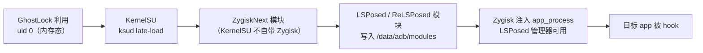

<!-- compiled_truth -->
## 链路

## 各环节的硬要求

| 环节 | 要求 | 备注 |
| --- | --- | --- |
| 利用 | uid 0，且要能写 `/data/adb` | ghostlock-app 提权后由 frontend 把 root 交给子进程 |
| KernelSU | 设备上装有带 `libksud.so` 的 root 管理器（KernelSU / ReSukiSU / BakaSU / KowSU） | app 会自动探测；没有 `ksud` 也能拿到 uid 0，但**装不了模块** |
| KernelSU 加载方式 | **late-load**（内存中加载，不改 boot） | 正好匹配「临时 root」语义：重启即失效 |
| Zygisk | KernelSU 不自带 Zygisk，需要 **ZygiskNext** 模块 | LSPosed 系依赖 Zygisk |
| LSPosed | 官方 LSPosed 已停更；用维护中的 **ReLSPosed / JingMatrix LSPosed** 系（需 Zygisk） | Android 15 需新版 |
| 生效范围 | 只在**本次开机窗口** | 重启后 root 与所有内存态模块都没了 |

## 为什么这条链子成立

临时 root 的「临时」只影响**生命周期**，不影响**能力**：只要在本次开机里拿到 uid 0，
就能把 KernelSU、ZygiskNext、LSPosed 全部以内存/模块目录方式装进去并立刻使用。
代价是每次开机都要重跑一遍利用（利用本身很快，profile 固定后是几分钟内的事）。

## 失效边界

- 利用必须每次开机重跑 → 自动化脚本有价值（`scripts/` 里预留）。
- LSPosed 模块若在 `/data/adb/modules` 里被「固化」成开机加载，KernelSU 没了就加载不了；
  late-load 场景下应理解为**本次窗口内的手动装载**。
- 设备一旦重启 → 回到原点。这与「永久 root」不是一回事，README 的非目标里已写明。

## Timeline

- time: 2026-10-21T03:35:20
  kind: decision
  summary: "Created this page: 从临时 root 到 LSPosed 生效的完整链路"
  source: "上游 ghostlock-app 文档 + KernelSU/LSPosed 生态常识"
  affects: [temp-root-to-lsposed]

- time: 2026-10-21T03:35:34
  kind: decision
  summary: "固化临时 root → LSPosed 的链路与失效边界"
  source: "上游 ghostlock-app 文档 + 生态常识"
  affects: [temp-root-to-lsposed]
