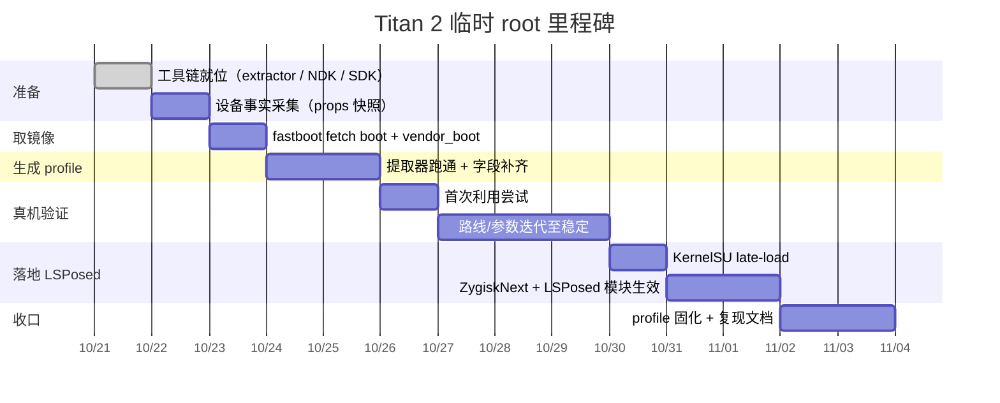

# Roadmap

## 里程碑判据

| 里程碑 | 判据 |
| --- | --- |
| t1 设备事实 | 拿到 `uname -r` 全串、SoC/内核家族、bootloader 锁定状态、SELinux 状态 |
| t2 取镜像 | 拿到与该 `uname -r` 对应的 `boot.img`（+ `vendor_boot.img`）；extractor 能读出 kallsyms |
| t3 profile | extractor 输出可被 app 解析；所有必填字段非 null；内核未打补丁（未触发退出码 6） |
| t4 首次利用 | 至少一次拿到 uid 0（失败也要留日志：失败阶段 + 现象） |
| t5 稳定 | 同一环境连续多次可复现；失败率可接受 |
| t6 KernelSU | `ksud` late-load 成功，KernelSU 管理器显示已注入 |
| t7 LSPosed | LSPosed 管理器可打开，模块能对目标 app 生效 |
| t8 收口 | profile 落到 submodule 并登记 `index.conf`；复现步骤写进 `docs/` |

## 风险与备用路径

- **内核已打补丁** → t3 判定失败，直接跳到「否定结论」分支：记录内核版本与补丁证据，
  评估其他临时 root 手段（等 OTA、解锁刷机、其他利用）。
- **fastboot fetch 不支持** → 改用官方固件包；若也没有，只能先取得任意 root 再 dump。
- **物理地址推不出** → 走 app 内高级参数覆盖页迭代；或利用成功后读 `/proc/iomem` 反推。
- **利用不稳定** → 降尝试次数、固定大核、降温重试；若长期不可用，评估 5.x `multicast_waiter`
  与 6.x `tcp_zerocopy` 路线互换。
