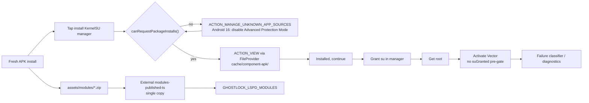

English | [简体中文](apk-only-vector-activation-design_ZH.md)

# APK-only Vector activation plan (2026-11-18)

## Current state and baseline

- Branch: current working tree. Baseline commit: `83833f9c435eaa1a43549e9b11e24750c5266a20`.
- Change level: **M outside the attack path**. No `src/core/**`, profile, wire, route, or exec-flow change is in scope.
- Current app flow: the user can install the bundled KernelSU manager from `assets/`, but a fresh install can stop at `MainActivity.installApk()` because `canRequestPackageInstalls()` is never checked and `ACTION_VIEW` fails. `module_fetch_kernelsu_no_installer` is then shown even when the real cause is "unknown sources" denial or Android 16 Advanced Protection Mode.
- Current activation flow: `onActivateFramework()` blocks on `repository.suGranted()`, while D6/F5 evidence says app-domain `su` probes are unreliable. `onRetrySuAuthorization()` only refreshes state. Vector manager installation is presented as required, although activation only needs the KernelSU manager (`ksud` + `su` handoff).
- Current module staging: `assets/modules/*.zip` is copied to `filesDir/modules/`, then copied again into `modules-published-<ts>` under the external files dir. Manual ZIP selection, `stageModuleZip`, and the `filesDir/modules` handoff are dead links.
- Warm-device evidence already exists, but a warm device has root, `ksud`, a `su` grant, and published module directories. It cannot prove that a never-adb, freshly installed device works.

## Goals and constraints

### Goal

A brand-new install on a device that has never been connected to adb can activate Vector using only the APK and taps on the phone.

### Non-goals

- Do not change `src/core/**`.
- Do not bundle `libksud.so`.
- Do not change profile, wire, route, or the zygote injection gate.
- Do not use root `pm install`.
- Do not add Manifest permissions.
- Do not verify manager APK signatures in this batch (`ComponentFetcher.kt:40-44` remains a tracked follow-up).

### Hard constraints

- Keep KernelSU manager and the phone-side guidance route (approved Route A).
- Vector manager becomes optional; do not gate activation on it.
- Keep `GHOSTLOCK_LSPD_MODULES` pointing at the external files dir.
- Keep the external path shape `Android/data/<pkg>/files/modules-published-<ts>`; no storage permission is needed.
- Keep FileProvider whitelist `cache-path name="component_apk" path="component-apk/"`.
- Keep Manifest declarations `REQUEST_INSTALL_PACKAGES` and `QUERY_ALL_PACKAGES`; `REQUEST_INSTALL_PACKAGES` is a declaration, not authorization.
- Do not add `MANAGE_EXTERNAL_STORAGE`.
- On Android 16 Advanced Protection Mode, tell the user to disable side-load protection; do not silently retry `ACTION_VIEW`.

## Affected files and behavior contracts

| File | Contract |
|---|---|
| `app/src/main/kotlin/com/ghostlock/app/ui/GhostlockViewModel.kt:869-892` | `onFetchKernelSuManager()` sends `GhostlockEffect.InstallApk(path, pending = PendingInstallAction.KERNELSU_MANAGER)`. `onFetchVectorManager()` uses `PendingInstallAction.VECTOR_MANAGER`. |
| `...GhostlockViewModel.kt:974-989` | `onActivateFramework()` no longer reads `repository.suGranted()` as a gate. It calls `runExploit(phase = "activate", needsRoot = true)` directly; a missing `su` grant is diagnosed only after the run fails. |
| `...GhostlockViewModel.kt:1006-1008` | `onRetrySuAuthorization()` reruns `onActivateFramework()` after refreshing state. It is a real retry, not a refresh-only action. |
| `...GhostlockViewModel.kt:1050-1120` | `runExploit()` records `ActivationFailure` from exit code and log tail instead of one generic error. `ActivationFailureClassifier.classify(phase, exitCode, logTail)` is the pure authority. |
| `...GhostlockViewModel.kt:1244-1300` | `refreshSnapshot()` publishes `ksudReady()` and `rootEstablishedInThisBoot()` as diagnostics. `suGranted` remains `GhostlockUiState.suGranted`, but has no gate semantics. |
| `app/src/main/kotlin/com/ghostlock/app/ui/GhostlockUI.kt:754-812` | `DialogType.SU_AUTH` says "grant not detected; activation will report the failing step; retry runs activation again". Retry button calls `onRetrySuAuthorization()`. |
| `...GhostlockUI.kt:789-796` | `DialogType.MANAGERS` lists Vector manager as optional; dismiss and "Later" remain available without installing it. |
| `...GhostlockUI.kt:901-906` | `ManagerSetupCard` only requires KernelSU manager; Vector manager row is informational/optional. |
| `app/src/main/kotlin/com/ghostlock/app/data/AndroidGhostlockRepository.kt:1174-1188` | `resolveKsudPath()` remains the single `ksud` resolver. `ksudReady(): Boolean` delegates to it without exposing the binary path to UI. |
| `...AndroidGhostlockRepository.kt:178-231` | Remove `stageLspdStackModules()` and `filesDir/modules` staging. `publishLspdModules()` publishes bundled zips directly from `assets/modules/` through `LspdModuleStaging.publish()`. |
| `...AndroidGhostlockRepository.kt:708-721` | Keep `GHOSTLOCK_LSPD_MODULES=<published external dir>` and `GHOSTLOCK_SELINUX_FIXUP=0`; do not alter the root-script contract. |
| `app/src/main/kotlin/com/ghostlock/app/ui/MainActivity.kt:153-166` | `installApk(path, pending)` checks `packageManager.canRequestPackageInstalls()` before `ACTION_VIEW`. If denied, open `Settings.ACTION_MANAGE_UNKNOWN_APP_SOURCES` for this package and keep the pending path. `module_fetch_kernelsu_no_installer` is shown only for `ActivityNotFoundException` after permission is granted. |
| `app/src/main/kotlin/com/ghostlock/app/runtime/ComponentDetector.kt` | `suGranted()` result is a diagnostic row. Do not use it to disable or gate activation. |
| `app/src/main/res/values/strings.xml`, `app/src/main/res/values-zh/strings.xml` | Add paired copy for install permission, Advanced Protection Mode, installed-continue, optional Vector manager, and SU_AUTH diagnosis. Keys and placeholders stay identical in both files. |

## Approved simplifications

1. Delete manual ZIP selection end-to-end: `DocumentRequest.ModuleZip`, `onPickModuleZip`, `stageModuleZip`, `GhostlockActions.onPickModuleZip`, and related picker strings. Delete `filesDir/modules` / `stagedModulesDir` handoff; no callers remain after this batch.
2. `LspdModuleStaging.publish()` enumerates `assets/modules/*.zip` and copies each zip once into a fresh external `modules-published-<ts>` directory. No `filesDir/modules` intermediate copy.
3. Preserve external published path and `GHOSTLOCK_LSPD_MODULES`; root script behavior is unchanged.
4. Vector manager is optional in UI and checks.
5. `SU_AUTH` retry truly reruns activation.
6. After returning from the installer, show "Installed, continue" and resume the pending install/activation continuation.

## Permission must-fix

- `canRequestPackageInstalls()` has zero current call sites. Add it before installer launch.
- `REQUEST_INSTALL_PACKAGES` in the Manifest only allows the app to request the install capability; it does not grant it.
- Denied permission must open `ACTION_MANAGE_UNKNOWN_APP_SOURCES` with `package:<own package>` and retry after return.
- Android 16 Advanced Protection Mode can block side-load even when the unknown-sources switch appears enabled. Show paired copy telling the user to turn off Advanced Protection Mode; do not misclassify as "no installer".
- External files dir needs no storage permission; keep no `MANAGE_EXTERNAL_STORAGE`.
- FileProvider path whitelist stays exactly `cache-path name="component_apk" path="component-apk/"`.
- `QUERY_ALL_PACKAGES` stays because `ManagerScanner` enumerates manager candidates.
- Manager APK signature checking is a later, separate item (`ComponentFetcher.kt:40-44`).

## Non-simplifiable list

- **D5 single-button worker + setcon:** reverted after kernel panic. Keep two user steps; do not merge get-root and activate into one automatic tap.
- **D2 kernel-domain exec denied:** `su`, `ksud`, and `sh` from `u:r:kernel:s0` return `Permission denied` even in permissive mode. Keep app-side `su` handoff and the app route ordering.
- **SELinux cross-domain read:** the `ksu` domain cannot read `/data/data/<pkg>`; keep publishing zips to the external files dir. Do not move staging back to private storage.
- **uid change:** a reinstall changes uid and leaves old external directories owned by the previous uid. Always create a fresh `modules-published-<ts>` directory.
- **UAPI=0:** before late-load, kernel UAPI is 0, so `ksud module install` rejects modules. Root script extracts into `/data/adb/modules_update` manually; do not switch to `ksud module install`.
- **late-load does not promote:** modules installed into `modules_update` need a later late-load to reach `/data/adb/modules`. Keep the ordered second late-load.
- **Status file boot_id guard:** app-domain `su`, `/proc/modules`, and sysfs probes are unreliable or unreadable. Use `.ghostlock_status` with `boot_id`; never use `state=ready` as the root gate.
- **Zygote injection gate:** keep `inject_state:1` and `modules64` containing `zygisk_vector` before killing zygote. Preserve detached finisher, socket/daemon checks, and the 90s gate; do not weaken recovery protection.

## Data-flow and control-flow differences

Before: private copy → external copy → `suGranted` pre-gate → refresh-only retry.
After: direct external copy → diagnostics only → real activation retry → explicit permission gate with continuation.

## Compatibility and rollback

- Existing installed builds keep their published directories; this batch only changes how new runs publish zips.
- Rollback is a Git revert of this batch. No data migration is required; old `filesDir/modules` copies may remain and are ignored.
- No native binary, profile, or wire change means no `cmp_disasm` requirement for this batch.

## Verification matrix

| Gate | Command / action | Expected evidence |
|---|---|---|
| Host unit tests | `make -C src native-host-tests` | 0 failures |
| Kotlin unit tests | `./gradlew :app:testDebugUnitTest` | New and existing tests PASS |
| NDK build | `make -C src ghostlock` | Build succeeds, zero warnings |
| Lint | `make -C src lint-tidy` | 0 findings |
| APK build | `./gradlew :app:assembleDebug` | Debug APK builds |
| Shape comparison | `python3 tools/cmp_disasm.py <baseline-binary> build/native/ghostlock` | May skip: no attack-path change |
| Phone-only smoke | Warm device, app-only: install manager, grant su, get root, activate Vector | Vector CLI / `state.json` shows active stack; no adb dependency |
| Clean-device negative | Never-adb, fresh install, no manager, no grant, unknown-sources denied | Settings deep link, correct copy, no `module_fetch_kernelsu_no_installer`, no activation before ksud/root readiness |
| Warm-device limitation | Record device state before smoke | Warm device does not prove first-install behavior; clean-device negative is mandatory |

## Progress

- [x] Design complete and approved as "merge A".
- [ ] Task 1: dead-link deletion and single-copy staging.
- [ ] Task 2: preflight contract and detector diagnostic.
- [ ] Task 3: ViewModel activation control flow.
- [ ] Task 4: UI and install permission entry.
- [ ] Task 5: full verification.

## Open points

None requiring user decision. Android 16 Advanced Protection Mode copy must be confirmed on the phone during the clean-device negative gate; wording changes stay inside this batch's string resources.
