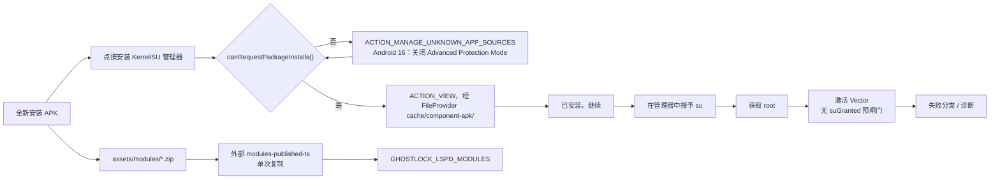

[English](apk-only-vector-activation-design.md) | 简体中文

# 仅 APK 激活 Vector 计划（2026-11-18）

## 当前状态与基线

- 分支：当前工作树。基线提交：`83833f9c435eaa1a43549e9b11e24750c5266a20`。
- 改动级别：**攻击路径外的 M 级**。不涉及 `src/core/**`、profile、wire、route 或 exec 流程。
- 当前安装流程：用户可以从 `assets/` 安装内置 KernelSU 管理器，但全新安装在 `MainActivity.installApk()` 可能停住：`canRequestPackageInstalls()` 全仓 0 调用，`ACTION_VIEW` 失败后会误报 `module_fetch_kernelsu_no_installer`，真实原因可能是「未知来源」被拒或 Android 16 Advanced Protection Mode。
- 当前激活流程：`onActivateFramework()` 以 `repository.suGranted()` 为闸门，而 D6/F5 证据表明 app 域 `su` 探测不可靠。`onRetrySuAuthorization()` 只刷新状态。Vector 管理器被呈现为必需，但激活实际只需要 KernelSU 管理器（`ksud` + `su` handoff）。
- 当前模块暂存：`assets/modules/*.zip` 先复制到 `filesDir/modules/`，再复制到外部 files dir 的 `modules-published-<ts>`。手动 ZIP 选择、`stageModuleZip` 与 `filesDir/modules` 中转均为死链。
- 暖机证据已存在，但暖机设备已有 root、`ksud`、`su` 授权和已发布模块目录，不能证明从未 adb 的全新安装成功。

## 目标与约束

### 目标

从未连接 adb 的全新设备，只靠 APK 与手机端点按即可激活 Vector。

### 非目标

- 不改 `src/core/**`。
- 不内置 `libksud.so`。
- 不改 profile、wire、route，不碰 zygote 注入门禁。
- 不用 root `pm install`。
- 不新增 Manifest 权限。
- 本批不做管理器 APK 签名校验（`ComponentFetcher.kt:40-44` 作为后续项）。

### 硬约束

- 保留 KernelSU 管理器与手机端引导路线（已批准路线 A）。
- Vector 管理器降为可选；不得以其作为激活闸门。
- 保留 `GHOSTLOCK_LSPD_MODULES` 指向外部 files dir。
- 保留外部路径形态 `Android/data/<pkg>/files/modules-published-<ts>`；无需存储权限。
- 保留 FileProvider 白名单 `cache-path name="component_apk" path="component-apk/"`。
- 保留 Manifest 声明 `REQUEST_INSTALL_PACKAGES` 与 `QUERY_ALL_PACKAGES`；`REQUEST_INSTALL_PACKAGES` 是声明，不是授权。
- 不添加 `MANAGE_EXTERNAL_STORAGE`。
- Android 16 Advanced Protection Mode 下提示用户关闭侧载保护；不得静默重试 `ACTION_VIEW`。

## 影响文件与行为契约

| 文件 | 契约 |
|---|---|
| `app/src/main/kotlin/com/ghostlock/app/ui/GhostlockViewModel.kt:869-892` | `onFetchKernelSuManager()` 发送 `GhostlockEffect.InstallApk(path, pending = PendingInstallAction.KERNELSU_MANAGER)`；`onFetchVectorManager()` 使用 `PendingInstallAction.VECTOR_MANAGER`。 |
| `...GhostlockViewModel.kt:974-989` | `onActivateFramework()` 不再以 `repository.suGranted()` 为闸门，直接调用 `runExploit(phase = "activate", needsRoot = true)`；缺少 `su` 授权只在运行失败后诊断。 |
| `...GhostlockViewModel.kt:1006-1008` | `onRetrySuAuthorization()` 刷新状态后重新调用 `onActivateFramework()`；必须是真实重试，不是仅刷新。 |
| `...GhostlockViewModel.kt:1050-1120` | `runExploit()` 根据退出码与日志尾部记录 `ActivationFailure`，替代泛化错误。纯函数权威为 `ActivationFailureClassifier.classify(phase, exitCode, logTail)`。 |
| `...GhostlockViewModel.kt:1244-1300` | `refreshSnapshot()` 发布 `ksudReady()` 与 `rootEstablishedInThisBoot()` 诊断。`suGranted` 仍写入 `GhostlockUiState.suGranted`，但无闸门语义。 |
| `app/src/main/kotlin/com/ghostlock/app/ui/GhostlockUI.kt:754-812` | `DialogType.SU_AUTH` 文案改为「未检测到授权；激活会报告失败步骤；重试会重新执行激活」。重试按钮调用 `onRetrySuAuthorization()`。 |
| `...GhostlockUI.kt:789-796` | `DialogType.MANAGERS` 将 Vector 管理器标为可选；不安装也可关闭／稍后。 |
| `...GhostlockUI.kt:901-906` | `ManagerSetupCard` 只要求 KernelSU 管理器；Vector 管理器行为提示性、可选。 |
| `app/src/main/kotlin/com/ghostlock/app/data/AndroidGhostlockRepository.kt:1174-1188` | `resolveKsudPath()` 仍是唯一 `ksud` 解析器。`ksudReady(): Boolean` 委托给它，不向 UI 暴露二进制路径。 |
| `...AndroidGhostlockRepository.kt:178-231` | 删除 `stageLspdStackModules()` 与 `filesDir/modules` 中转。`publishLspdModules()` 通过 `LspdModuleStaging.publish()` 直接从 `assets/modules/` 发布。 |
| `...AndroidGhostlockRepository.kt:708-721` | 保留 `GHOSTLOCK_LSPD_MODULES=<已发布外部目录>` 与 `GHOSTLOCK_SELINUX_FIXUP=0`；不改 root 脚本契约。 |
| `app/src/main/kotlin/com/ghostlock/app/ui/MainActivity.kt:153-166` | `installApk(path, pending)` 在 `ACTION_VIEW` 前检查 `packageManager.canRequestPackageInstalls()`；被拒时打开本包的 `Settings.ACTION_MANAGE_UNKNOWN_APP_SOURCES` 并保留 pending 路径。只有在权限已授予后 `ActivityNotFoundException` 才显示 `module_fetch_kernelsu_no_installer`。 |
| `app/src/main/kotlin/com/ghostlock/app/runtime/ComponentDetector.kt` | `suGranted()` 结果仅作诊断行，不用于禁用或闸门化激活。 |
| `app/src/main/res/values/strings.xml`、`app/src/main/res/values-zh/strings.xml` | 成对新增安装权限、Advanced Protection Mode、安装后续跑、Vector 可选、SU_AUTH 诊断文案；两份 key 与占位符一致。 |

## 已批准简化项

1. 全链删除手动 ZIP 选择：`DocumentRequest.ModuleZip`、`onPickModuleZip`、`stageModuleZip`、`GhostlockActions.onPickModuleZip` 及相关 picker 字符串。删除 `filesDir/modules` / `stagedModulesDir` 中转；本批后无调用方。
2. `LspdModuleStaging.publish()` 枚举 `assets/modules/*.zip`，每个 zip 只复制一次到新的外部 `modules-published-<ts>` 目录，不再走 `filesDir/modules`。
3. 保留外部发布路径与 `GHOSTLOCK_LSPD_MODULES`；root 脚本行为不变。
4. Vector 管理器在 UI 与检查中降为可选。
5. `SU_AUTH` 的「重试」真实重跑激活。
6. 从安装器返回后显示「已安装，继续」，续跑 pending 的安装／激活后续动作。

## 权限必修

- `canRequestPackageInstalls()` 当前 0 调用；发起安装前加入检查。
- Manifest 中的 `REQUEST_INSTALL_PACKAGES` 只允许应用请求安装能力，不等于已授权。
- 权限被拒时必须打开 `ACTION_MANAGE_UNKNOWN_APP_SOURCES`（`package:<自身包名>`），返回后重试。
- Android 16 Advanced Protection Mode 即使未知来源开关看似开启也可能阻止侧载。显示成对文案提示用户关闭；不得误报「无安装器」。
- external files dir 不需要存储权限；保持无 `MANAGE_EXTERNAL_STORAGE`。
- FileProvider 路径白名单保持精确为 `cache-path name="component_apk" path="component-apk/"`。
- `QUERY_ALL_PACKAGES` 保留，因为 `ManagerScanner` 枚举管理器候选。
- 管理器 APK 签名校验是后续单独事项（`ComponentFetcher.kt:40-44`）。

## 不可简化清单

- **D5 单按钮 worker + setcon：** 曾导致内核 panic 并已回滚。保留两个用户步骤，不合并「获取 root」与「激活 Vector」为一次自动点按。
- **D2 kernel 域 exec denied：** `u:r:kernel:s0` 执行 `su`、`ksud`、`sh` 一律 `Permission denied`，permissive 下也一样。保留 app 侧 `su` handoff 与 app route 顺序。
- **SELinux 跨域读：** `ksu` 域读不了 `/data/data/<pkg>`；保持把 zip 发布到外部 files dir，不退回私有目录。
- **uid 变化：** 重装会换 uid，旧外部目录属主仍是旧 uid。始终创建新的 `modules-published-<ts>` 目录。
- **UAPI=0：** late-load 前内核 UAPI 为 0，`ksud module install` 会拒绝模块。root 脚本手工解压到 `/data/adb/modules_update`，不得改回 `ksud module install`。
- **late-load 不 promote：** `modules_update` 中的模块需要后续一次 late-load 才能进入 `/data/adb/modules`。保留有序的第二次 late-load。
- **状态文件 boot_id guard：** app 域 `su`、`/proc/modules`、sysfs 探测不可靠或不可读。使用带 `boot_id` 的 `.ghostlock_status`；绝不用 `state=ready` 作为 root 闸门。
- **zygote 注入门禁：** 杀 zygote 前保留 `inject_state:1` 且 `modules64` 含 `zygisk_vector`。保留 detached finisher、socket/daemon 检查与 90 秒门禁，不削弱 recovery 保护。

## 数据流与控制流差异

修改前：私有目录复制 → 外部复制 → `suGranted` 预闸门 → 仅刷新重试。
修改后：直接外部复制 → 仅诊断 → 真实激活重试 → 显式权限闸门与续跑。

## 兼容性与回滚

- 已安装构建保留其已发布目录；本批只改变新运行的发布方式。
- 回滚方式为 Git revert 本批改动；无需数据迁移，旧 `filesDir/modules` 副本可保留并被忽略。
- 无 native binary、profile 或 wire 改动，因此本批无 `cmp_disasm` 要求。

## 验证矩阵

| 门槛 | 命令 / 动作 | 预期证据 |
|---|---|---|
| 主机单测 | `make -C src native-host-tests` | 0 失败 |
| Kotlin 单测 | `./gradlew :app:testDebugUnitTest` | 新增与既有用例 PASS |
| NDK 构建 | `make -C src ghostlock` | 构建成功，零告警 |
| Lint | `make -C src lint-tidy` | 0 findings |
| APK 构建 | `./gradlew :app:assembleDebug` | Debug APK 构建成功 |
| 形状对比 | `python3 tools/cmp_disasm.py <baseline-binary> build/native/ghostlock` | 可跳过：无攻击路径改动 |
| 手机-only 冒烟 | 暖机设备，仅 app：安装管理器、授予 su、获取 root、激活 Vector | Vector CLI / `state.json` 显示栈已激活；无 adb 依赖 |
| 干净设备负向 | 从未 adb、全新安装、无管理器、无授权、未知来源被拒 | 跳设置页、文案正确、不出现 `module_fetch_kernelsu_no_installer`、ksud/root 未就绪时不激活 |
| 暖机局限 | 冒烟前记录设备状态 | 暖机设备不能证明首装行为；干净设备负向必做 |

## 进度

- [x] 设计完成并已按「并入 A」批准。
- [ ] 任务 1：删除死链与单次复制。
- [ ] 任务 2：前置检查契约与探测器诊断。
- [ ] 任务 3：ViewModel 激活控制流。
- [ ] 任务 4：UI 与安装权限入口。
- [ ] 任务 5：全量验证。

## 开放点

无需用户拍板的开放点。Android 16 Advanced Protection Mode 文案须在干净设备负向门槛中真机确认；措辞调整仍在本批字符串资源范围内。
