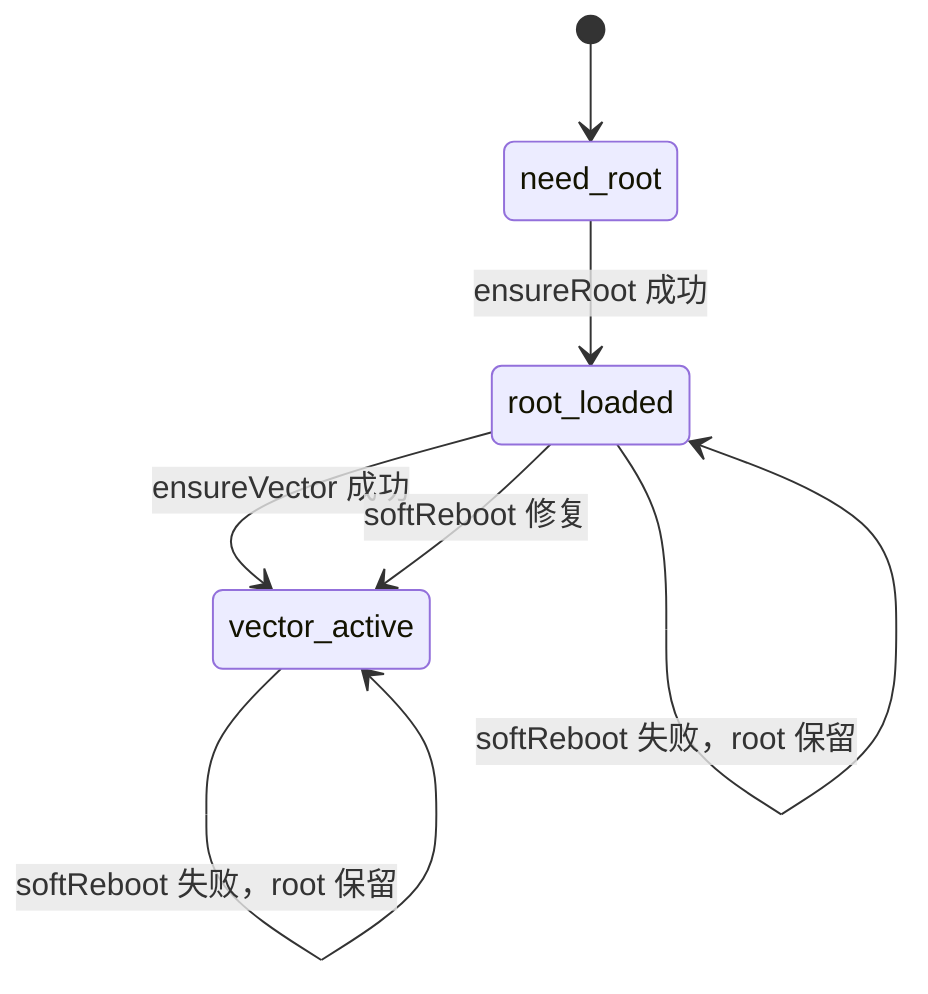

# 框架激活流程与交互契约

状态：三阶段实现完成，待真机验证。
适用：Unihertz Titan 2 / MT6878 / Android 16 / 临时 root。
约束：**不依赖 PC**；root 失败可接受；框架激活失败必须可见且不得进 recovery。

## 1. 目标

不依赖 PC，完成三个独立操作：

```text
获取临时 root
激活 Vector
随时软重启（保留 root 与 Vector 激活）
```

root、Vector 激活、软重启必须分开。root 阶段只拿临时 root，**不装模块、不杀 zygote**；Vector 激活只依赖 root；软重启只依赖 root，不要求 supervisor 还活着。

## 2. 前置条件（分阶段）

### 2.1 root 前

1. 组件包已 staged（ReZygisk 或 ZygiskNext + Vector）。

manager 不是 root 的硬前置：可能以前已授权；root 阶段先跑，授权缺失时再安装 manager。

### 2.2 框架激活前（root 后）

1. 临时 root 已建立。
2. `su -c id -u` 返回 `0`。
3. 若上一步非 0，才要求 manager 已安装并完成授权。

为什么不能把授权放在 root 前：KernelSU 还没加载时没有 su 服务，manager 无法授权；先要求授权会形成循环依赖，用户永远过不去。

任一不满足：

- 当前阶段不启动；
- 不杀 zygote；
- 只显示缺失项和对应操作按钮。

## 3. 三个独立操作

只能通过三条独立入口执行；每条失败都停留在本阶段，不拖累其他阶段。

### 3.1 `ensureRoot`（获取 root）

```text
检查组件
→ exploit
→ late-load
→ 验证 su -c id -u = 0
```

不装模块、不杀 zygote。root 已存在则直接跳过利用。

### 3.2 `ensureVector`（激活 Vector）

前置：`root=loaded`。

```text
安装/更新模块（已装且版本匹配则跳过）
→ 启动 ReZygisk monitor
→ 门禁 1：pidof zygisk-ptrace64 且 TracerPid == monitor
→ 杀 zygote64
→ 门禁 2：znctl 报 zygote_states:1 且 modules64 含 zygisk_vector
→ 等 60 秒让注入稳定
→ 启动 vectord
→ 等 20 秒；cli status / state.json / pid 校验
→ vector=active（**不再第二次杀 zygote**）
```
任一门禁失败都**不启动 vectord、不再杀 zygote**，只报失败阶段。模块安装失败、monitor 失败、注入门禁失败、Vector 校验失败分别可见，可单独重试。

### 3.3 `softReboot`（软重启）

前置：`root=loaded`。不要求 `vector=active`，因为 Vector 失败时它是修复入口。

```text
停止旧 supervisor
→ 确认 root
→ 确认 monitor 正在 trace init
→ 杀 zygote64
→ 等注入
→ vectord 缺失才重启
→ cli status 校验
→ root 不变，vector=active
```

不重装模块、不重新跑 exploit、不调用 late-load、不重启整机。

## 4. 状态机



状态文件字段：

```text
boot_id, state, busy, ready, error, pid, log, updated
```

`state`：`root|applying|zygote|soft_reboot|daemon|ready|failed`。

`ready=1` 只表示最后一次 zygote 重启与 Vector 校验通过；软重启入口只看 `root=loaded`，不看 `ready`。

## 5. 主界面

固定一张“框架激活”卡片。所有操作按钮**始终显示**，只按条件 disable；不隐藏。

### 5.1 依赖状态

卡片内固定三行，始终显示：

```text
KernelSU 管理器   已安装 / 未安装     [打开]
临时 root         已获取 / 未获取     [获取 root]
GhostLock 授权    未检查 / 检查中 / 已授权 / 未授权   [检查授权]
```

- 初次显示“未检查”，不能直接写“未授权”。
- root 成功后自动检查一次；如果以前已授权，直接变“已授权”。
- app 冷启动时若临时 root 已在：显示“未检查”，不自动弹窗；只有同一 boot 的上次 run 处于 `rooting/authorizing/activating` 时才自动检查一次。
- 授权检查是 single-flight；检查中超时只写“检查超时”，不写“未授权”。
- 执行检查本身可能触发 manager 授权窗口；文案写“检查/请求授权”，不能承诺绝不弹窗。
- 状态不能靠 toast 通知；结果写入对应行和日志。

```text
┌ 框架 ─────────────────────────────┐
│ 准备                               │
│ 管理器    已安装   [打开]           │
│ 临时 root 已获取   [获取 root]       │
│ 授权      已授权   [检查授权]        │
│ 状态：……                            │
│ [ 激活 Vector ] [ 软重启 ]          │
│ [ 查看日志 ]                        │
└────────────────────────────────────┘
```

- 激活 Vector：只做 root 之后的三阶段激活；不重新拿 root。
- 软重启：只重启 zygote；保留 root 和模块，不重装。
- 查看日志：随时打开完整日志面板。

### 按钮矩阵

| 按钮 | 始终显示 | disable 条件 |
|---|---|---|
| 激活 Vector | 是 | root 未获取 / `running` / `setupBusy` |
| 软重启 | 是 | root 未获取 / `running` / `setupBusy` |
| 获取 root | 是 | root 已获取 或 `running` |
| 打开管理器 | 是 | manager 未安装 或 `running` |
| 检查授权 | 是 | root 未获取、检查中，或 `running` |
| 查看日志 | 是 | 否 |

按钮只改变 enabled 状态，不改变可见性。软重启**不依赖** `setupReady`。

### 5.2 状态与按钮

| 状态 | 激活 Vector | 软重启 |
|---|---|---|
| root 未获取 | disabled | disabled |
| root 已获取 | enabled | enabled |
| 操作进行中 | disabled | disabled |

## 6. 引导（无准备对话框）

点“激活框架”时不再弹准备对话框。动作固定为：

1. 打开完整日志面板。
2. 写入 `activation: requested` 和当前缺失项。
3. 依赖行保留对应操作按钮，用户直接在卡片里补前置。

授权成功后日志写 `authorization: granted`，授权行变“已授权”，激活按钮可继续。

### 6.1 已 root、未授权：管理器授权引导

引导文案写入日志和授权行，不使用对话框：
引导步骤：

```text
1. 点“打开管理器”。
2. 进入“超级用户 / Superuser”。
3. 找到 GhostLock，打开允许开关。
4. 返回本页，点“检查授权”。

如果列表里没有 GhostLock：
先点“请求授权”，等系统弹出授权窗口后允许；
窗口没出现，再回管理器手动添加。
```

依赖行始终显示 `[打开管理器]` 和 `[检查授权]`，不隐藏按钮。

| 按钮 | disable 条件 |
|---|---|
| 打开管理器 | manager 未安装 |
| 请求授权 | root 未获取、检查中 |
| 检查授权 | root 未获取、检查中 |

- “请求授权”执行 `su -c id -u`，主动触发 manager 授权窗口；
- “检查授权”也执行 `su -c id -u`，但只用于确认；未授权时可能同样触发 manager 弹窗，不能承诺绝不弹；
- app 从 manager 返回时自动检查一次；
- 授权成功：日志写 `authorization: granted`，依赖行变“已授权”，激活按钮可用；
- **授权成功不自动开始激活**：自动检查只更新授权状态，用户必须再点一次“激活框架”。授权是前置条件，不是激活触发器。
- 拒绝或 20 秒超时：日志写“未获得授权，可重试或到管理器手动允许”，依赖行保留“检查授权”；
- 不自动重复弹窗，避免骚扰。

### 6.1.1 以前已经授权

允许“之前已经授权过”的情况，不要先入为主显示“未授权”：

- app 启动时授权状态是“未检查”；root 成功后自动执行一次 `su -c id -u`。
- 返回 0：直接显示“已授权”，跳过授权提示，激活按钮直接进入“激活框架”。
- manager 已卸载但 su 仍可用：也允许继续，不强制重装 manager。
- app 更新/重装后 UID 可能变化，manager 里可能残留旧 GhostLock 条目：检查失败时提示“删除旧条目后重新允许当前安装”，而不是只说未授权。

### 6.1.2 检查时机与超时

- 自动检查只发生两次：root 成功之后；从 manager 返回 app 之后。
- 冷启动时临时 root 还在，但上次 run 不是进行中：显示“未检查”，不自动弹窗。
- 同一时刻只允许一个检查；重复点击直接复用进行中的检查。
- 20 秒没有结果：状态写“检查超时”，日志保留，按钮可重试；不写“未授权”。
- 用户拒绝：状态写“未授权”，不自动重试。
- 检查成功：写“已授权”，日志写 granted，激活按钮变为可用。

### 6.2 请求授权没有弹窗

不假设 `su` 一定能从 app 命名空间触发 manager 弹窗。按顺序兜底：

1. **请求授权后没有任何窗口**：
   回到 manager → “超级用户 / Superuser” → 添加应用/手动添加 → GhostLock → 允许。
2. **manager 里已允许，但“检查授权”仍失败**：
   完全关闭 GhostLock 再重开（不要重启手机）；临时 root 仍在。
3. **重开后仍失败**：
   检查 manager 的允许列表是否保存；再点“请求授权”一次。
4. 三条都不成立时，只显示“授权不可用”，不启动激活，不尝试绕过 su。

### 6.3 授权阶段硬约束

- root 阶段只拿临时 root，不装模块、不杀 zygote。
- 授权检查失败时，不启动激活脚本。
- 授权成功前不显示“正在激活”，只显示“等待授权”。
- app 被杀死后重开，授权状态重新检查，不缓存为成功。

## 6.4 分支决策树

点击“激活框架”后的唯一判定顺序：

```text
1. 正在 root/激活/重载 → 禁用，不弹窗
2. root 未获取 → root 分支
3. 组件缺失 → 组件分支
4. 授权未检查 → 自动检查一次
5. 授权检查中 → 禁用
6. 授权超时 → “检查超时”，可重试
7. 授权被拒 → 授权引导
8. manager 缺失且未授权 → 安装/打开 manager
9. 已授权 → activating
10. active → 软重启可用
```

### root 分支

| 分支 | 处理 |
|---|---|
| native 未运行 | 点“获取 root”启动 root-only |
| root 运行中 | 禁用所有阶段按钮 |
| root 失败 | `failed` + 原因；只允许重试 root |
| root 成功 | 自动进入授权检查 |
| app 被杀后重开 | 有 root marker → 视为已 root；无 marker 且状态未知 → “root 状态未知”，允许重新检查/重试 |
| 整机重启 | boot_id 变化 → root/授权/phase 全部重置 |

### 组件分支

| 分支 | 处理 |
|---|---|
| 组件缺失 | 显示缺失项和 staging 操作；不启动激活 |
| staging 中 | 禁用激活 |
| staging 失败 | 显示失败原因，可重试 staging |
| 组件就绪 | 继续授权/激活判定 |

### manager 分支

| 分支 | 处理 |
|---|---|
| 未安装 | “安装管理器”enabled；“打开”disabled |
| 安装取消 | 保持未安装，不报错，不自动重试 |
| 安装被系统阻止 | 提示“允许安装未知应用”，给系统设置操作 |
| 安装失败 | 显示失败原因 |
| 多个候选 | 先选 manager，再打开 |
| 无启动入口 | 显示包名，提示从系统设置打开 |

### 授权分支

| 分支 | 处理 |
|---|---|
| `su` 返回 0 | 已授权，日志写 granted |
| 明确拒绝 | 未授权，不自动重试 |
| 20 秒无结果 | 检查超时，取消进程，可重试 |
| `su` 不存在 | 引导 manager 手动添加 |
| 检查中 app 被杀 | 重开后若 phase=authorizing，自动检查一次 |
| UID 变化/旧条目 | 提示删除旧条目，重新允许当前安装 |
| 授权中途撤销 | 下一次激活 su 失败 → `failed`，回到未授权 |

### 激活分支

每个 step 失败都写 `step` + `error`，只允许重试激活，不回到 root：

| step | 失败处理 |
|---|---|
| modules | 保留 root/su，重试激活 |
| late-load | 重试激活 |
| zygote | 不重复杀进程，先检查状态再重试 |
| daemon | 读取 `vectord.log` 后重试 |
| verify | 显示 CLI/state/pid 哪项失败 |
| reload | 重试软重启；monitor 丢失则回激活 |

## 6.5 重试规则

- 不自动重试；所有重试由用户点“重试”。
- root 失败只重试 root；auth 失败只重试 auth；激活失败只重试激活。
- 重试前清空上一轮的 `error`，保留日志。
- 同一个失败原因连续出现两次，界面提示“查看日志”，不再只显示重试。
- reboot/panic 后不沿用旧 phase，回到“未检查/未获取”。

## 6.6 引导文案清单

原则：引导必须告诉用户“现在在哪、缺什么、点哪里、下一步是什么”。不隐藏按钮，不只报错。

### 6.6.1 首次进入

标题：`准备顺序`

```text
1. 组件包已内置，不需要下载。
2. 安装 KernelSU 管理器（只需一次）。
3. 获取临时 root。
4. 在管理器中允许 GhostLock。
5. 点“激活框架”。

重启手机后临时 root 会消失，需要重新获取。
```

### 6.6.2 安装管理器

标题：`安装 KernelSU 管理器`

```text
管理器用于授权 GhostLock 和查看模块。
安装包已内置，不需要联网。

如果系统提示“禁止安装未知应用”：
允许当前文件管理器/浏览器安装未知应用后重试。
```

按钮：`[安装管理器] [打开管理器] [检查授权] [取消]`

安装取消：保持“未安装”，不自动重试。

### 6.6.3 打开管理器

标题：`打开 KernelSU 管理器`

```text
请在管理器里完成 GhostLock 的 root 授权。
如果安装了多个管理器，先选择当前 KernelSU 对应的那个。

如果点击没有反应：
从系统设置 → 应用 → KernelSU 管理器 → 打开。
```

### 6.6.4 授权 GhostLock

标题：`在 KernelSU 管理器中允许 GhostLock`

```text
1. 打开管理器。
2. 进入“超级用户 / Superuser”。
3. 找到 GhostLock，打开允许开关。
4. 回到本页，点“检查授权”。

列表里没有 GhostLock：
点“请求授权”，等系统授权窗口出现后允许。

已经允许但检查仍失败：
完全关闭 GhostLock 再重开；不要重启手机。

更新/重装过 GhostLock：
删除管理器里的旧 GhostLock 条目，再允许当前安装。

检查超过 20 秒：
显示“检查超时”，可以再点一次。
```

按钮：`[打开管理器] [请求授权] [检查授权] [取消]`

### 6.6.5 root 失败

标题：`获取临时 root 失败`

```text
本轮没有进入框架激活。
可以点“重试 root”；不要连续快速点击。
如果设备已重启，旧状态会清空，重新获取即可。
```

### 6.6.6 组件缺失

标题：`组件包未准备好`

```text
缺少：<组件名>
点“准备组件”重新 staging。
组件未齐时不会启动激活。
```

按钮：`[准备组件] [查看日志] [取消]`

### 6.6.7 激活中

标题：`正在激活框架`

```text
当前步骤：<root/modules/zygote/daemon/verify>

重启 zygote 时 app 会被系统杀掉，这是正常的；只重启这一次。
重新打开 GhostLock，会继续显示进度。
不要重复点“激活框架”，也不要在此时手动杀 zygote。
```

### 6.6.8 激活失败

标题：`框架激活失败`

```text
失败步骤：<step>
原因：<error>

先看日志确认原因，再点“重试”。
同一原因连续失败两次时，优先复制日志排查，不要反复点击。
```

按钮：`[重试] [复制日志] [取消]`

### 6.6.9 软重启

软重启只重启 zygote，不重新 root、不重装模块、不重启手机。

```text
执行时 app 会被杀掉；重新打开后从状态文件恢复。
root 与已安装模块保留；Vector 在重启后重新校验。
```

按钮：`[软重启]`。只要 root 已获取就可点，不依赖 `setupReady`。日志写 `op:reboot start/kill/ok/fail`；失败显示具体阶段，root 不丢，可再次软重启。

### 6.6.10 重启/panic 后

标题：`上次运行没有正常结束`

```text
设备重启后临时 root 和激活状态都已失效。
请重新获取 root，再激活框架。
如果刚发生 panic，先看日志，不要立即重复运行。
```

## 7. 失败与日志

- 失败必须写 `state=failed` + `error`，界面持久显示。
- 所有内核/系统操作必须写日志：开始、成功、失败；不允许 silent `runCatching`。
- 框架卡始终有 `[查看日志]`；用户主动触发的内核/系统操作自动打开日志。
- 日志面板内不放操作按钮，只保留复制、关闭、回到最新。
- 日志用 `LazyColumn` 滚动；选择文本只包单行，不阻断滚动手势。
- 完整日志：本次 run 的 native + ksu 日志，按行 offset 追加，不截断、不去重、不只取尾部。
- 日志面板可滚动；只有用户在底部时才自动跟随新行。
- 不允许 toast 承担激活结果。
- 无状态但日志存在：显示“未收到 supervisor 状态”，日志仍可展开。
- app 侧日志写 `files/ghostlock-ui.log`，每行立即 flush；重开时恢复最近 4000 行。
- 进程重开不自动弹出日志面板；框架卡 `[查看日志]` 始终可点。打开时从磁盘重读，内存只作显示缓存。
- 操作派发不依赖 `viewModelScope`：Activity 关闭不取消已派发的 root/supervisor 操作。
- 日志分源：app 侧 `op:` / `result:`，root 侧 `op:activation` / `op:reboot` / `[ksu]`；不伪造跨进程总顺序。

## 8. 验收用例

1. 未装 manager → 点激活 → 日志打开并写缺失原因，native 未启动。
2. 装了未授权 → 点激活 → 日志打开，native 未启动。
3. 拒绝授权 → 显示未授权，native 未启动。
4. 授权成功 → 激活到 ready，`[软重启]` 可点，日志有完整步骤。
5. 激活中 app 被杀 → 重开显示同一 run 的步骤与完整日志。
6. 激活失败 → 显示具体 `error`，不出现第二个 root script。
7. 整机重启 → 旧状态不误报；run marker 给出“重启结束”。
8. 所有操作按钮在上述状态下只 disable，不消失。
9. “请求授权”没有弹窗 → 引导到 manager 手动添加，不循环启动 native。
10. manager 已允许但检查失败 → 重开 GhostLock 后检查成功，不要求重启手机。
11. root 阶段结束 → zygote 未被杀、模块未安装，只显示“待授权”。
12. 授权被拒后点激活 → 仍停在授权阶段，不进入 activating。
13. 以前已授权 → root 成功后自动检查返回 0，跳过授权提示，停在“已授权”，等用户点“激活 Vector”。
14. app 重装后 manager 里残留旧 GhostLock → 检查失败提示删除旧条目并重新允许当前安装。
15. manager 已卸载但 su 仍可用 → 允许继续激活，不强制重装 manager。
16. 冷启动时 root 还在、上次 run 不在进行中 → 状态“未检查”，不自动弹授权窗口。
17. 检查超时 → 状态“检查超时”，不是“未授权”，可直接重试。
18. manager 未安装但 su 已可用 → 允许“检查授权”，不强制安装 manager。
19. root 失败 → 只重试 root，不进入授权/激活。
20. 组件缺失 → 先显示组件分支，不先弹 manager。
21. manager 安装被系统阻止 → 提示去允许未知来源，不循环安装。
22. 多个 manager → 先选再打开，不能默认开错。
23. 授权中途撤销 → 激活失败写入 state=failed，下一次检查回未授权。
24. 激活某一步失败 → 只重试激活，不重新拿 root。
25. 授权成功 → 自动检查只更新授权状态，**不自动开始激活**；用户再点“激活 Vector”才进入激活。
26. 激活/软重启中 app 被杀 → 重开不自动弹日志；点“查看日志”能看到 app 侧已落盘的行和 root 侧行。
27. 日志面板只在用户点击或操作触发时打开；进程重开不自动弹。
28. Activity 被关闭或旋转 → 已派发的 root 操作不被取消；重开从状态文件恢复。
29. `[获取 root]` 完成 → zygote 未被杀、模块未安装，root 状态为已获取。
30. 激活失败（模块/monitor/注入/Vector 校验）→ 显示具体阶段；root 保持已获取，可直接重试激活。
31. 软重启成功 → root 仍可用，`state.json` 含 `zygisk_vector`，`cli status` 通过。
32. `znctl status` 没有 `zygote_states:1` 或 `modules64` 没有 `zygisk_vector` → 不启动 vectord、不再杀 zygote，写 `zygote injection gate failed`。
33. 激活成功 → 全程只杀一次 zygote64；之后不再重启 zygote，设备不进 recovery。

### 8.1 十次边界实验结论

1. **没 manager、没 root**：日志先写“临时 root 未就绪”，manager 不是 root 前置；两者按钮都显示，root 优先。
2. **以前已授权、冷启动**：显示“未检查”；点“激活框架”时先自动检查一次；成功只更新为“已授权”，不自动激活，用户再点一次才进入激活。
3. **检查超时**：取消挂起的 su 进程，写“检查超时”；用户从 manager 返回时重新检查，不与旧检查并发。
4. **多个 manager**：有多个候选时先让用户选，再“打开管理器”；不能默认打开错的那个。
5. **manager 无启动入口**：显示包名和“请在系统设置中打开”，不假装已打开。
6. **重装后旧 UID**：提示删除旧 GhostLock 条目并重新允许当前安装；检查成功即可继续。
7. **整机重启**：boot_id 变化后 root/授权/phase 全部重置为“未检查/未获取”，不显示旧“已授权”。
8. **授权中途撤销**：激活脚本的 su 调用失败 → `state=failed`；下一次检查回到未授权，不自动重试激活。
9. **组件缺失**：先写组件缺失和 staging 操作，组件未齐不启动激活。
10. **重复点击/被杀**：同一时间只允许一个授权检查；auth 阶段被杀，重开自动检查一次，其他阶段重开只恢复状态，不自动重跑。

## 9. 可用性契约（Nielsen 10 heuristics）

| # | 原则 | 本应用落地 |
|---|---|---|
| 1 | 系统状态可见 | 框架卡显示流程提示与阶段文案；`starting/applying/zygote/...` 映射成动作描述；结果写状态行与日志，不靠 toast。 |
| 2 | 贴合真实世界 | 用“获取 root / 激活 Vector / 软重启”；不把 `stage2`、`waiting_injection` 直接暴露给用户。 |
| 3 | 用户控制与自由 | 三个操作各自可重试；授权成功不自动激活；软重启必须用户点击；日志面板可关闭、可回到底部。 |
| 4 | 一致性与标准 | root/activate/reboot 三个 phase 使用同一套状态、错误、日志前缀；按钮始终显示，只 disable。 |
| 5 | 错误预防 | monitor 未接管 init 绝不杀 zygote；模块安装失败立即失败；root 失败不进入授权/激活；同一时间只允许一个操作。 |
| 6 | 识别优于回忆 | 卡片固定显示流程提示和三行依赖；错误信息带阶段；用户不需要记住上一步做了什么。 |
| 7 | 灵活高效 | 激活失败只重试激活，不重新 root；软重启只依赖 root；日志可复制；管理器可直接打开。 |
| 8 | 美观与最小化 | 主界面只保留一张框架卡；准备对话框取消；日志按需打开；不重复展示同一状态。 |
| 9 | 帮助诊断与恢复 | 失败写到具体阶段（模块/monitor/注入/Vector 校验），并保留 root；用户可只修失败的那一段。 |
| 10 | 帮助与文档 | 卡片内一行流程说明；日志使用 `op:` / `result:` / `[ksu]` 标记；完整契约见本文档。 |

验收时逐条检查；不满足时优先改状态文案、按钮 enable 规则或失败分支，不新增流程。

## 10. 非目标

- 不做持久 root。
- 不依赖 adb/PC 完成激活。
- 不在前置缺失时偷偷尝试 in-process 安装。
- 不在未通过 stage2 校验时自动软重启。
